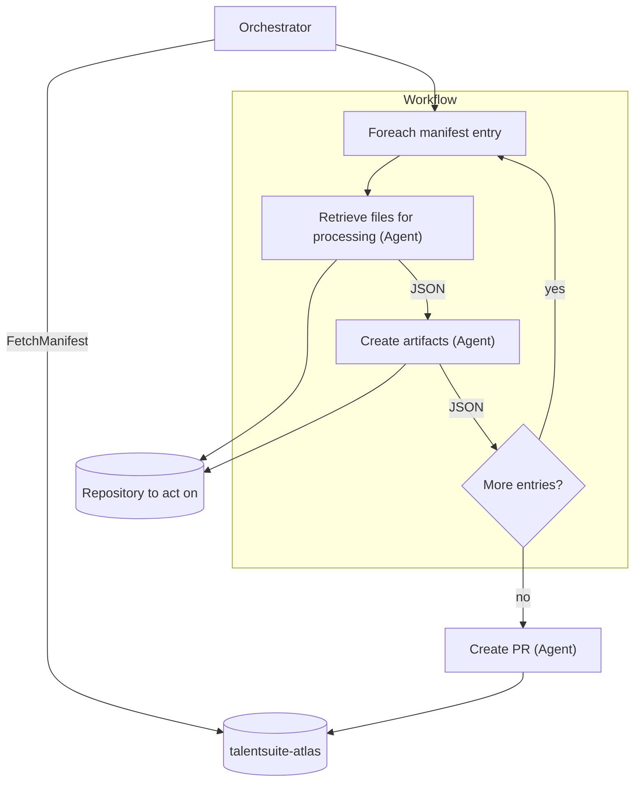
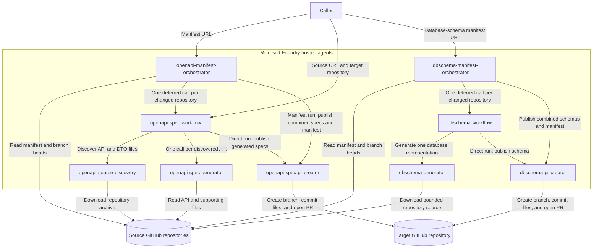

# Source Control Agent Pipelines

This repository contains Azure AI Foundry hosted agents for manifest-driven source analysis. The OpenAPI, database-schema, event/command-catalog, external-service-dependency, local-development-configuration, and .NET-version pipelines generate repository artefacts and create one combined pull request for all successful manifest entries.

## Pattern

Every pipeline in this repository follows the same shape: an orchestrator fetches the manifest from `talentsuite-atlas`, then for each manifest entry a discovery agent retrieves the relevant files from the repository being analyzed and a generator agent turns them into structured artifacts, looping until every entry has been processed. Once the loop completes, one PR-creator agent commits every generated artifact back into `talentsuite-atlas` in a single pull request.



## Pipeline

1. [`openapi-source-discovery`](agents/hosted/openapi/openapi-source-discovery/README.md) scans one GitHub repository path and returns a root JSON array of `{apiFile, supportingFiles}` objects.
2. [`openapi-spec-generator`](agents/hosted/openapi/openapi-spec-generator/README.md) accepts one discovery element and returns an OpenAPI 3.1 JSON object.
3. [`openapi-spec-pr-creator`](agents/hosted/openapi/openapi-spec-pr-creator/README.md) accepts all generated specs, writes them to a destination repository, and opens a pull request.
4. [`openapi-spec-workflow`](agents/hosted/openapi/openapi-spec-workflow/README.md) runs the complete sequence, invoking the generator once per discovered API and sending the combined result to the PR creator.
5. [`openapi-manifest-orchestrator`](agents/hosted/openapi/openapi-manifest-orchestrator/README.md) checks manifest commit hashes and creates one combined specs-and-manifest pull request for changed repositories.

### Agent interactions and dependencies



The dependency order is:

- `openapi-source-discovery`, `openapi-spec-generator`, and `openapi-spec-pr-creator` are leaf agents and can be deployed independently.
- `openapi-spec-workflow` depends on all three leaf agents.
- `openapi-manifest-orchestrator` depends on `openapi-spec-workflow` and `openapi-spec-pr-creator`.
- `dbschema-generator` and `dbschema-pr-creator` are database-schema leaf agents.
- `dbschema-workflow` depends on both leaf agents.
- `dbschema-manifest-orchestrator` depends on `dbschema-workflow` and `dbschema-pr-creator`.
- `eventcatalog-source-discovery`, `eventcatalog-generator`, and `eventcatalog-pr-creator` are leaf agents.
- `eventcatalog-workflow` depends on those three leaf agents.
- `eventcatalog-manifest-orchestrator` depends on `eventcatalog-workflow` and `eventcatalog-pr-creator`.
- `service-dependency-source-discovery`, `service-dependency-generator`, and `service-dependency-pr-creator` are leaf agents.
- `service-dependency-workflow` depends on those three leaf agents.
- `service-dependency-manifest-orchestrator` depends on `service-dependency-workflow` and `service-dependency-pr-creator`.
- `local-dev-config-source-discovery`, `local-dev-config-generator`, and `local-dev-config-pr-creator` are leaf agents.
- `local-dev-config-workflow` depends on those three leaf agents.
- `local-dev-config-manifest-orchestrator` depends on `local-dev-config-workflow` and `local-dev-config-pr-creator`.
- `repo-metadata-source-discovery` and `repo-metadata-pr-creator` are leaf agents; `repo-metadata-generator` is also a leaf agent but is fully deterministic (no model call).
- `repo-metadata-workflow` depends on those three leaf agents.
- `repo-metadata-manifest-orchestrator` depends on `repo-metadata-workflow` and `repo-metadata-pr-creator`.
- `user-journeys-source-discovery`, `user-journeys-generator`, and `user-journeys-pr-creator` are leaf agents; discovery is fully deterministic (no model call).
- `user-journeys-workflow` depends on those three leaf agents.
- `user-journeys-manifest-orchestrator` depends on `user-journeys-workflow` and `user-journeys-pr-creator`.

Previous workflows, scripts, prompt agents, and documentation are retained under [`backup/`](backup/).

## Tenants and GitHub access

One set of agents serves every tenant. A tenant is identified by its **data repository**: the repo that holds its `manifest.json` and the generated catalogues. The manifest URL a run is started with names it. For each run the agents mint one-hour tokens from the TalentSuite Atlas GitHub App installation that covers the data repo: a read-only token for source code and the manifest, and a write token limited to the data repo for pull requests. Tokens stay inside the agents and are never passed in requests. Setting up the App is described in [DEPLOYMENT.md](DEPLOYMENT.md#tenants-and-the-atlas-github-app).

In the diagrams, green links use the read-only token, pink links use the write token, pink boxes are what the App installation covers, dashed outlines are GitHub organisations, and the dashed orange link doesn't work yet.

### A company with public source repos

In this example, Northwind's source code is public and its data repo, `northwind-atlas`, lives in `talentconsulting`. The App is installed only on that data repo. The read token can fetch public repos, so Northwind doesn't install anything.


### A company with private source repos (Acme)

The company installs the App on its own organisation and keeps its data repo there, so one installation covers both the private sources and the data repo. A run for one tenant can't reach another tenant's private repos.


The generators (every flow except user-journeys) still fetch individual files without a token, so they fail on private repos until they're changed to use the tenant's read token.

### Keep the data repo beside private sources

Tokens always come from the installation that covers the data repo. If a company's data repo lived in `talentconsulting`, its token couldn't read the company's private repos.


| | Public source repos (Northwind) | Private source repos (Acme) |
| --- | --- | --- |
| Who installs the App | Talent Consulting, on `talentconsulting` | Acme, on its own organisation |
| What the installation covers | `northwind-atlas` | `acme-atlas` and every private repo in the manifest |
| Where the data repo lives | `talentconsulting` | Acme's organisation |
| App setting "Where can this GitHub App be installed?" | "Only on this account" is enough | "Any account" |
| Viewer | A Render service reading `northwind-atlas` | A Render service reading `acme-atlas` |

To onboard a company with private repos:

1. Change the generators to fetch files with the tenant's read token.
2. Set the App's "Where can this GitHub App be installed?" to "Any account".
3. The company creates a data repo in its organisation with a `manifest.json`, then installs the App on the data repo and every private repo in the manifest.
4. Run [Run All Flows](#run-every-flow-against-one-repository) with the company's manifest URL. Pull requests arrive in its data repo.
5. Deploy a Render viewer that reads the company's data repo.

## Database schema orchestration

[`dbschema-generator`](agents/hosted/dbschema/dbschema-generator/README.md) scans a repository path for database entities and returns tables, columns, relationships, indexes, and named types. Each table also carries a `hasPii` flag -- the model's best-effort judgement on whether any of its columns plausibly holds personal data, for a human reviewer to check, never a certified compliance determination. [`dbschema-workflow`](agents/hosted/dbschema/dbschema-workflow/README.md) generates and optionally publishes one repository schema. [`dbschema-manifest-orchestrator`](agents/hosted/dbschema/dbschema-manifest-orchestrator/README.md) invokes one deferred workflow per changed repository and sends all successful schemas plus the updated manifest to [`dbschema-pr-creator`](agents/hosted/dbschema/dbschema-pr-creator/README.md) in one request.

## Event and command catalog orchestration

[`eventcatalog-source-discovery`](agents/hosted/eventcatalog/eventcatalog-source-discovery/README.md) deterministically selects message and handler files. [`eventcatalog-generator`](agents/hosted/eventcatalog/eventcatalog-generator/README.md) extracts validated commands, events, fields, and handlers. [`eventcatalog-workflow`](agents/hosted/eventcatalog/eventcatalog-workflow/README.md) writes one `<repository>/event-catalog/events-and-commands.json` file through [`eventcatalog-pr-creator`](agents/hosted/eventcatalog/eventcatalog-pr-creator/README.md), while [`eventcatalog-manifest-orchestrator`](agents/hosted/eventcatalog/eventcatalog-manifest-orchestrator/README.md) combines changed repositories and the manifest update into one PR.

## Service dependency orchestration

[`service-dependency-source-discovery`](agents/hosted/servicedependencies/service-dependency-source-discovery/README.md) deterministically selects client, registration, configuration, messaging, database, cache, storage, and cloud-integration sources. [`service-dependency-generator`](agents/hosted/servicedependencies/service-dependency-generator/README.md) extracts a validated catalog without returning secret values. [`service-dependency-workflow`](agents/hosted/servicedependencies/service-dependency-workflow/README.md) writes one `<repository>/service-dependencies/service-dependencies.json` file through [`service-dependency-pr-creator`](agents/hosted/servicedependencies/service-dependency-pr-creator/README.md), while [`service-dependency-manifest-orchestrator`](agents/hosted/servicedependencies/service-dependency-manifest-orchestrator/README.md) processes only `service-dependencies` nodes and combines changed repositories with the manifest update in one PR.

```json
{
  "github-repo": "https://github.com/owner/application",
  "service-dependencies": {
    "path-to-scan": "tree/main/src",
    "last-commit-hash-scanned": ""
  }
}
```

## Local dev config orchestration

[`local-dev-config-source-discovery`](agents/hosted/localdevconfig/local-dev-config-source-discovery/README.md) deterministically selects docker-compose files, `.env` examples, and application configuration files that can evidence the local services a repository needs to run. [`local-dev-config-generator`](agents/hosted/localdevconfig/local-dev-config-generator/README.md) extracts a validated catalog of local services and configuration key names, without returning secret values. [`local-dev-config-workflow`](agents/hosted/localdevconfig/local-dev-config-workflow/README.md) writes one `<repository>/local-dev-config/local-dev-config.json` file through [`local-dev-config-pr-creator`](agents/hosted/localdevconfig/local-dev-config-pr-creator/README.md), while [`local-dev-config-manifest-orchestrator`](agents/hosted/localdevconfig/local-dev-config-manifest-orchestrator/README.md) processes only `local-dev-config` nodes and combines changed repositories with the manifest update in one PR.

```json
{
  "github-repo": "https://github.com/owner/application",
  "local-dev-config": {
    "path-to-scan": "tree/main/src",
    "last-commit-hash-scanned": ""
  }
}
```

## Repository metadata orchestration

[`repo-metadata-source-discovery`](agents/hosted/repometadata/repo-metadata-source-discovery/README.md) deterministically selects `.csproj` and `global.json` files, ignoring `bin`, `obj`, `packages`, and `node_modules`. [`repo-metadata-generator`](agents/hosted/repometadata/repo-metadata-generator/README.md) deterministically parses each file's XML/JSON directly -- no model is used -- into target framework and SDK version entries. [`repo-metadata-workflow`](agents/hosted/repometadata/repo-metadata-workflow/README.md) writes one `<repository>/repo-metadata/repo-metadata.json` file through [`repo-metadata-pr-creator`](agents/hosted/repometadata/repo-metadata-pr-creator/README.md), while [`repo-metadata-manifest-orchestrator`](agents/hosted/repometadata/repo-metadata-manifest-orchestrator/README.md) processes only `repo-metadata` nodes and combines changed repositories with the manifest update in one PR. The catalog also includes a `lastCommitDate` field, the scanned path's most recent commit timestamp; this pipeline is intended to gather additional repository metadata over time, beyond just .NET versions.

The catalog's `dotnetSupport` field reports, for each distinct target framework moniker found across a repository's `projects`, its Microsoft-published end-of-support date and LTS/STS phase -- useful for a "which services are on soon-to-be-unsupported .NET" report. It has two limitations: it's a **static, hardcoded lookup table** in `repo-metadata-generator`, not a live query, so it needs manual maintenance whenever Microsoft ships a new .NET version or revises a support date (roughly once a year, each November) and can go stale if not updated; and it only covers modern .NET (`net5.0` onward) and .NET Core (`netcoreapp1.0`-`netcoreapp3.1`) monikers -- .NET Framework monikers (`net48`, `net472`, ...) and .NET Standard monikers (`netstandard2.0`, ...) always come back with `endOfSupport: null`, deliberately, since .NET Framework support tracks the host Windows OS lifecycle rather than a fixed date of its own, and .NET Standard is a spec rather than a runtime with its own support lifecycle.

```json
{
  "github-repo": "https://github.com/owner/application",
  "repo-metadata": {
    "path-to-scan": "tree/main/src",
    "last-commit-hash-scanned": ""
  }
}
```

## User journeys orchestration

For web repositories only. [`user-journeys-source-discovery`](agents/hosted/userjourneys/user-journeys-source-discovery/README.md) builds each ASP.NET web project's navigation graph deterministically: pages (named routes and Razor Pages), the links, form posts and redirects between them with the file and line of each, whether sign-in is required, and entry points. [`user-journeys-generator`](agents/hosted/userjourneys/user-journeys-generator/README.md) uses the model only to describe that graph (a purpose per page, a condition per transition) and to name the user journeys through it; journeys whose steps are not transitions in the graph are rejected. [`user-journeys-workflow`](agents/hosted/userjourneys/user-journeys-workflow/README.md) writes `<repository>/user-journeys/user-journeys.json` and a Mermaid rendering, `user-journeys.md`, through [`user-journeys-pr-creator`](agents/hosted/userjourneys/user-journeys-pr-creator/README.md), while [`user-journeys-manifest-orchestrator`](agents/hosted/userjourneys/user-journeys-manifest-orchestrator/README.md) processes only `user-journeys` nodes and combines changed repositories with the manifest update in one PR.

```json
{
  "github-repo": "https://github.com/owner/application-web",
  "user-journeys": {
    "path-to-scan": "tree/main/src",
    "last-commit-hash-scanned": ""
  }
}
```

## Run the complete workflow

Invoke `openapi-spec-workflow` with:

```json
{
  "sourceUrl": "https://github.com/owner/application/tree/main/src/Api",
  "targetRepository": "owner/api-specifications",
  "targetDirectory": "application/open-api",
  "targetBaseBranch": "main"
}
```

Only `sourceUrl` and `targetRepository` are required. The response is always JSON and contains discovery/generation counts, per-file generation errors, and the PR creator result including `pullRequestUrl`.

Generated file paths are deterministic and flat. By default, `src/Api/BidsController.cs` from the `application` repository becomes `application/open-api/BidsController.openapi.json`.

## Run every flow against one repository

[`.github/workflows/run-all-flows.yml`](.github/workflows/run-all-flows.yml) is a manual (`workflow_dispatch`) action that looks up one repository's entry in a manifest and invokes every `*-workflow` agent that has a node on that entry,  OpenAPI, database schema, event/command catalog, service dependency, C4, local dev config, and repository metadata,  in parallel. Each flow uses its own `path-to-scan` from the manifest entry (they are not all the same subdirectory), so, for example, `dbschema` might scan `src/Data` while `eventcatalog` scans `src/Application` for the same repository. The destination repository and base branch are derived from the manifest URL itself, matching the convention the `*-manifest-orchestrator` agents already use. Inputs:

| Input | Required | Notes |
| --- | --- | --- |
| `manifest_url` | Yes | Manifest blob URL, e.g. `https://github.com/talentconsulting/talentsuite-atlas/blob/main/manifest.json`. Its repository and branch become `targetRepository`/`targetBaseBranch`. |
| `github_repo` | Yes | The exact `github-repo` value to match in the manifest, e.g. `https://github.com/owner/application`. |
| `flows` | No | `all` (default) or a comma-separated subset of `openapi,dbschema,eventcatalog,service-dependency,local-dev-config,repo-metadata,user-journeys`. Only flows actually present on the matched entry ever run. |
| `defer_publication` | No | When `true`, generates artefacts without opening pull requests. |

A `prepare` job resolves the manifest entry into a matrix (via [`.github/workflows/scripts/manifest-entry-flows.jq`](.github/workflows/scripts/manifest-entry-flows.jq)) and fails fast with a clear error if the repository or none of the requested flow nodes are found. Each matched flow then runs as its own matrix job with `fail-fast: false`, so one flow failing does not stop the others; results are written to the job summary. This runs the direct per-repository workflow agents (not the manifest orchestrators), so it does not update `last-commit-hash-scanned` in the manifest,  it's for on-demand runs, not a replacement for the scheduled manifest orchestration.

## Cost comparison

These agents call Azure OpenAI (`gpt-4o` by default) on a standard pay-as-you-go basis, billed per token. The alternative would be provisioned/reserved capacity (Azure OpenAI PTUs) or a self-hosted GPU running an open-weight model. The table below estimates monthly spend across a manifest of 100 repositories, assuming ~5-10k tokens per agent invocation (source files in, generated artefact out) and up to 6 agent types (`openapi`, `dbschema`, `eventcatalog`, `repo-metadata`, `service-dependency`, `local-dev-config`) potentially running per changed repository.

| Schedule | Repos changed | Invocations/month | Tokens/month | Pay-as-you-go | PTU (reserved, 15 PTU min.) | Self-hosted GPU (A100, 24/7) |
| --- | --- | --- | --- | --- | --- | --- |
| Nightly | ~50% | 1,500 – 9,000 | ~10.5M – 63M | ~£35 – £210 | ~£8,200/month | ~£2,100/month |
| Weekly | ~50% | 215 – 1,300 | ~1.5M – 9M | ~£5 – £30 | ~£8,200/month | ~£2,100/month |
| Weekly | 100% | 430 – 2,600 | ~3M – 18M | ~£11 – £64 | ~£8,200/month | ~£2,100/month |

The PTU and GPU columns are flat costs, not scaled by usage: a provisioned deployment bills for reserved capacity whether or not it's called, and a self-hosted GPU costs the same whether idle or busy. Both are estimated from a global minimum GPT-4o PTU deployment (15 PTUs at ~£0.75/PTU-hour) and a single Azure NC-series A100 80GB VM (~$3.67/hour) run continuously,  an H100 instead of an A100 roughly doubles the GPU figure to ~£4,000/month. Reserved capacity only becomes cheaper than pay-as-you-go once sustained usage passes roughly 150-200M tokens/month at 50%+ utilization; every schedule above sits one to two orders of magnitude below that, so pay-as-you-go remains the cheapest option unless usage grows well beyond a nightly/weekly batch across 100 repositories.

These figures are estimates from third-party pricing guides and assumed token volumes, not measured usage or an official Microsoft rate card,  verify current PTU and pay-as-you-go rates via the [Azure OpenAI pricing page](https://azure.microsoft.com/en-us/pricing/details/azure-openai/) or the Azure Retail Prices API, and check Azure Cost Management/Foundry metrics for actual spend, before budgeting.

## Deploy

Deploy in dependency order:

```bash
cd agents/hosted/openapi/openapi-source-discovery
azd deploy openapi-source-discovery --no-prompt

cd ../openapi-spec-generator
azd deploy openapi-spec-generator --no-prompt

cd ../openapi-spec-pr-creator
azd deploy openapi-spec-pr-creator --no-prompt

cd ../openapi-spec-workflow
azd deploy openapi-spec-workflow --no-prompt

cd ../openapi-manifest-orchestrator
azd deploy openapi-manifest-orchestrator --no-prompt
```

Each project also has a deployment workflow under `.github/workflows/`. See [DEPLOYMENT.md](DEPLOYMENT.md) for Azure/GitHub configuration and permissions.

The database-schema agents can be deployed in their current dependency order:

```bash
cd agents/hosted/dbschema/dbschema-generator
azd deploy dbschema-generator --no-prompt

cd ../dbschema-pr-creator
azd deploy dbschema-pr-creator --no-prompt

cd ../dbschema-workflow
azd deploy dbschema-workflow --no-prompt

cd ../dbschema-manifest-orchestrator
azd deploy dbschema-manifest-orchestrator --no-prompt
```

The manifest orchestrator is initially manual and has no schedule. Invoke it with one manifest blob URL; a Foundry routine can be added later for recurring execution.

The event catalog agents use the same dependency order:

```bash
cd agents/hosted/eventcatalog/eventcatalog-source-discovery
azd deploy eventcatalog-source-discovery --no-prompt

cd ../eventcatalog-generator
azd deploy eventcatalog-generator --no-prompt

cd ../eventcatalog-pr-creator
azd deploy eventcatalog-pr-creator --no-prompt

cd ../eventcatalog-workflow
azd deploy eventcatalog-workflow --no-prompt

cd ../eventcatalog-manifest-orchestrator
azd deploy eventcatalog-manifest-orchestrator --no-prompt
```

The service-dependency agents use the same dependency order:

```bash
cd agents/hosted/servicedependencies/service-dependency-source-discovery
azd deploy service-dependency-source-discovery --no-prompt

cd ../service-dependency-generator
azd deploy service-dependency-generator --no-prompt

cd ../service-dependency-pr-creator
azd deploy service-dependency-pr-creator --no-prompt

cd ../service-dependency-workflow
azd deploy service-dependency-workflow --no-prompt

cd ../service-dependency-manifest-orchestrator
azd deploy service-dependency-manifest-orchestrator --no-prompt
```

The local-dev-config agents use the same dependency order:

```bash
cd agents/hosted/localdevconfig/local-dev-config-source-discovery
azd deploy local-dev-config-source-discovery --no-prompt

cd ../local-dev-config-generator
azd deploy local-dev-config-generator --no-prompt

cd ../local-dev-config-pr-creator
azd deploy local-dev-config-pr-creator --no-prompt

cd ../local-dev-config-workflow
azd deploy local-dev-config-workflow --no-prompt

cd ../local-dev-config-manifest-orchestrator
azd deploy local-dev-config-manifest-orchestrator --no-prompt
```

The repo-metadata agents use the same dependency order:

```bash
cd agents/hosted/repometadata/repo-metadata-source-discovery
azd deploy repo-metadata-source-discovery --no-prompt

cd ../repo-metadata-generator
azd deploy repo-metadata-generator --no-prompt

cd ../repo-metadata-pr-creator
azd deploy repo-metadata-pr-creator --no-prompt

cd ../repo-metadata-workflow
azd deploy repo-metadata-workflow --no-prompt

cd ../repo-metadata-manifest-orchestrator
azd deploy repo-metadata-manifest-orchestrator --no-prompt
```

The user-journeys agents use the same dependency order:

```bash
cd agents/hosted/userjourneys/user-journeys-source-discovery
azd deploy user-journeys-source-discovery --no-prompt

cd ../user-journeys-generator
azd deploy user-journeys-generator --no-prompt

cd ../user-journeys-pr-creator
azd deploy user-journeys-pr-creator --no-prompt

cd ../user-journeys-workflow
azd deploy user-journeys-workflow --no-prompt

cd ../user-journeys-manifest-orchestrator
azd deploy user-journeys-manifest-orchestrator --no-prompt
```

## Test

```bash
python3 -m unittest discover -s agents/hosted/openapi/openapi-source-discovery/src/openapi-source-discovery -p 'test_*.py'
python3 -m unittest discover -s agents/hosted/openapi/openapi-spec-generator/src/openapi-spec-generator -p 'test_*.py'
python3 -m unittest discover -s agents/hosted/openapi/openapi-spec-pr-creator/src/openapi-spec-pr-creator -p 'test_*.py'
python3 -m unittest discover -s agents/hosted/openapi/openapi-spec-workflow/src/openapi-spec-workflow -p 'test_*.py'
python3 -m unittest discover -s agents/hosted/openapi/openapi-manifest-orchestrator/src/openapi-manifest-orchestrator -p 'test_*.py'
python3 -m unittest discover -s agents/hosted/dbschema/dbschema-manifest-orchestrator/src/dbschema-manifest-orchestrator -p 'test_*.py'
python3 -m unittest discover -s agents/hosted/dbschema/dbschema-generator/src/dbschema-generator -p 'test_*.py'
python3 -m unittest discover -s agents/hosted/dbschema/dbschema-pr-creator/src/dbschema-pr-creator -p 'test_*.py'
python3 -m unittest discover -s agents/hosted/dbschema/dbschema-workflow/src/dbschema-workflow -p 'test_*.py'
python3 -m unittest discover -s agents/hosted/eventcatalog/eventcatalog-source-discovery/src/eventcatalog-source-discovery -p 'test_*.py'
python3 -m unittest discover -s agents/hosted/eventcatalog/eventcatalog-generator/src/eventcatalog-generator -p 'test_*.py'
python3 -m unittest discover -s agents/hosted/eventcatalog/eventcatalog-pr-creator/src/eventcatalog-pr-creator -p 'test_*.py'
python3 -m unittest discover -s agents/hosted/eventcatalog/eventcatalog-workflow/src/eventcatalog-workflow -p 'test_*.py'
python3 -m unittest discover -s agents/hosted/eventcatalog/eventcatalog-manifest-orchestrator/src/eventcatalog-manifest-orchestrator -p 'test_*.py'
python3 -m unittest discover -s agents/hosted/servicedependencies/service-dependency-source-discovery/src/service-dependency-source-discovery -p 'test_*.py'
python3 -m unittest discover -s agents/hosted/servicedependencies/service-dependency-generator/src/service-dependency-generator -p 'test_*.py'
python3 -m unittest discover -s agents/hosted/servicedependencies/service-dependency-pr-creator/src/service-dependency-pr-creator -p 'test_*.py'
python3 -m unittest discover -s agents/hosted/servicedependencies/service-dependency-workflow/src/service-dependency-workflow -p 'test_*.py'
python3 -m unittest discover -s agents/hosted/servicedependencies/service-dependency-manifest-orchestrator/src/service-dependency-manifest-orchestrator -p 'test_*.py'
python3 -m unittest discover -s agents/hosted/localdevconfig/local-dev-config-source-discovery/src/local-dev-config-source-discovery -p 'test_*.py'
python3 -m unittest discover -s agents/hosted/localdevconfig/local-dev-config-generator/src/local-dev-config-generator -p 'test_*.py'
python3 -m unittest discover -s agents/hosted/localdevconfig/local-dev-config-pr-creator/src/local-dev-config-pr-creator -p 'test_*.py'
python3 -m unittest discover -s agents/hosted/localdevconfig/local-dev-config-workflow/src/local-dev-config-workflow -p 'test_*.py'
python3 -m unittest discover -s agents/hosted/localdevconfig/local-dev-config-manifest-orchestrator/src/local-dev-config-manifest-orchestrator -p 'test_*.py'
python3 -m unittest discover -s agents/hosted/repometadata/repo-metadata-source-discovery/src/repo-metadata-source-discovery -p 'test_*.py'
python3 -m unittest discover -s agents/hosted/repometadata/repo-metadata-generator/src/repo-metadata-generator -p 'test_*.py'
python3 -m unittest discover -s agents/hosted/repometadata/repo-metadata-pr-creator/src/repo-metadata-pr-creator -p 'test_*.py'
python3 -m unittest discover -s agents/hosted/repometadata/repo-metadata-workflow/src/repo-metadata-workflow -p 'test_*.py'
python3 -m unittest discover -s agents/hosted/repometadata/repo-metadata-manifest-orchestrator/src/repo-metadata-manifest-orchestrator -p 'test_*.py'
python3 -m unittest discover -s agents/hosted/userjourneys/user-journeys-source-discovery/src/user-journeys-source-discovery -p 'test_*.py'
python3 -m unittest discover -s agents/hosted/userjourneys/user-journeys-generator/src/user-journeys-generator -p 'test_*.py'
python3 -m unittest discover -s agents/hosted/userjourneys/user-journeys-pr-creator/src/user-journeys-pr-creator -p 'test_*.py'
python3 -m unittest discover -s agents/hosted/userjourneys/user-journeys-workflow/src/user-journeys-workflow -p 'test_*.py'
python3 -m unittest discover -s agents/hosted/userjourneys/user-journeys-manifest-orchestrator/src/user-journeys-manifest-orchestrator -p 'test_*.py'
```
